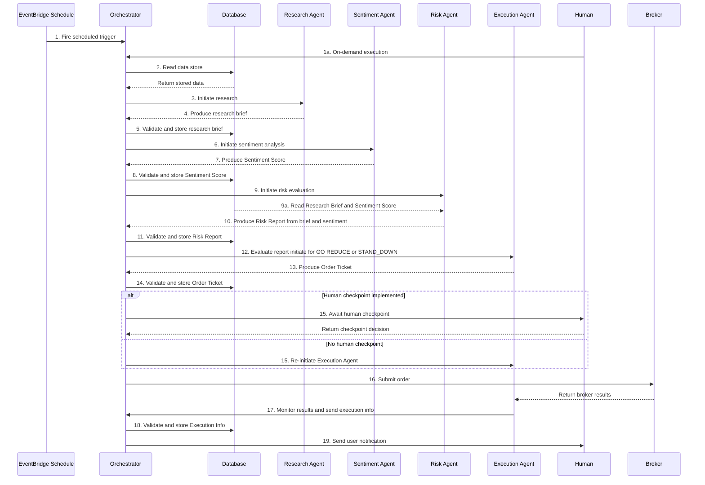

## Agent Team

**Orchestrator** - Routes signals. Validates outputs against schemas. Branches on Go/Reduce/Stand Down. Atuhority: Escalates exceptions. Owns every memory write. Holds the schedule. Reads the kill-switch flag first, every cycle.

**Research Agent** - Reads market data, calendar, watchlist, episodic memory, and semantic memory. Writes the seven-field pre-trade brief. Authority: produce briefs only. Cannot size. Cannot execute.  

Pre-trade Brief Schema: 
-   Instrument — the symbol the brief is about. One value.  
-   Bias — long, short, or flat. One of three values. No prose.  
-   Key_levels — support, resistance, and invalidation. Three numeric values.  
-   Catalyst_risk — a list of scheduled events inside the decision window, each with a timestamp and an impact rating.  
-   Confidence — a float between 0.00 and 1.00. The agent’s calibrated probability that the bias is correct.
-   Reasoning_trace — a three-bullet summary of why the agent reached this bias. Not a paragraph. Three bullets. 
-   Timestamp — ISO 8601 with time zone. Set by the agent at write time, not by the scheduler.

**Sentiment Agent** - Reads news feed, social feed (after the manipulation filter), and the Research brief. Writes a two-field score (sentiment_score plus confidence) and a data_insufficient flag. Authority: score sentiment only. Cannot trade.  

Sentiment Score Schema:
-   Score - between -1.00 (bearish) and +1.00 (bullish)
-   Confidence - between 0.00 and +1.00
-   Data Insuffient - TRUE or FALSE

**Risk Agent** - Reads Research brief, Sentiment score, your rule set, and procedural memory. Writes Go / Reduce / Stand Down plus a size multiplier between 0.25 and 1.00. Authority: VETO. Can halt the pipeline. No other agent can.  

**Execution Agent** - Reads Risk decision, broker connection, and slippage log. Writes the order ticket and the fill

### Authorization Boundaries

Risk Agent can halt the pipeline. No other agent can.  

Orchestrator can escalate. Agents can request escalation; only the Orchestrator routes it.  

No agent can rewrite its own goal. The system prompt is set by the human, full stop.  

Authorities **never** delegated: 
- hard-rule changes, 
- ladder phase promotion, 
- watchlist additions, and 
- account size increases.

## Data Stores (Agent Memory)

DynamoDB with time series archive in S3.

**Episodic** - Every signal, every cycle, with full context. Eighteen fields per record.  

**Semantic** - Strategy rules, instrument profiles, market structure definitions. Doesn’t change from session to session. Updated on the quarterly review.  

**Procedural** - Per-setup outcomes, calibration scores, and slippage history. The Risk Agent reads this back at the start of every cycle.

**Accounts** - User's investment accounts (401k, IRA, etc.)

**Positions** - Holdings in each account

**Instruments** - ETFs, stocks, and funds with current prices and allocation data (shared reference data)

**Users** - Minimal user data (Clerk handles auth)

**Jobs** - Async job tracking of agent executions

## Signal Flow Sequence Diagram

